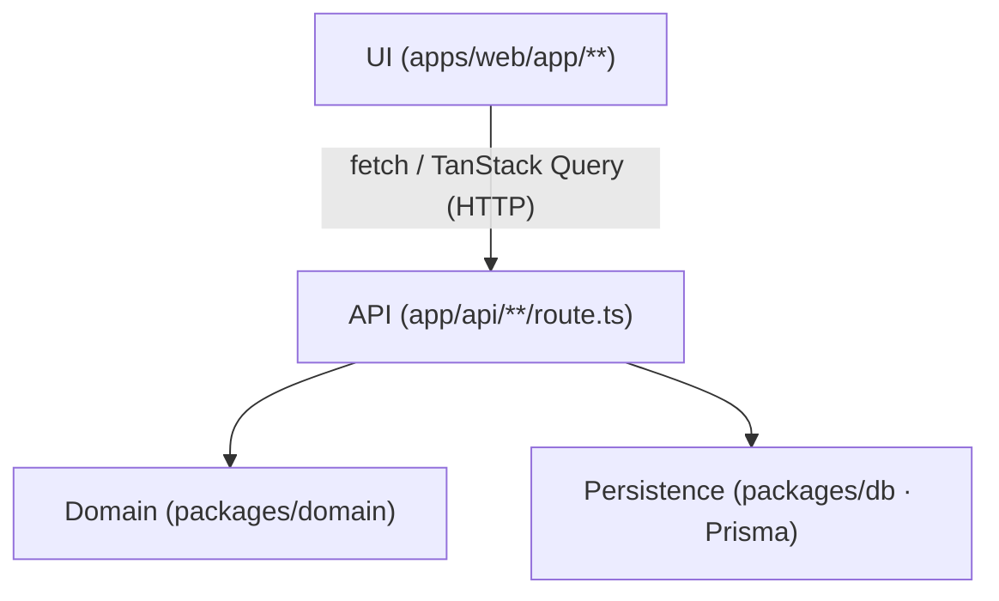

# Architecture Spine — Training Sanctum — Flashcards

## Design Paradigm

**Layered monolith with an isolated pure-domain core** (hexagonal-lite): one Next.js deployable, but the algorithmic heart (SM-2 scheduling, import parsing, duplicate detection) lives in a framework-free TypeScript package with zero knowledge of HTTP, React, or the database — unit-testable with nothing mocked, callable only through the API layer.

| Layer | Namespace | Role |
| --- | --- | --- |
| UI | `apps/web/app/**` (pages, components) | Renders state, calls the API over HTTP via TanStack Query. Never imports domain or db packages directly. |
| API (adapter) | `apps/web/app/api/**/route.ts` | Sole boundary. Validates input (Zod), calls domain for decisions, calls db for persistence, owns transactions. |
| Domain (core) | `packages/domain` | Pure functions: SM-2 engine, import parsing, duplicate detection. No HTTP/React/Prisma imports. |
| Persistence | `packages/db` | Prisma schema, generated client, migrations. No business logic. |



Dependency direction is one-way, top to bottom. Domain and Persistence have no outgoing edges to API or UI, and no edge to each other — the API layer is the only thing that knows both exist.

## Invariants & Rules

### AD-1 — Domain isolation

- **Binds:** all layering; FR-8, FR-6, FR-7
- **Prevents:** scheduling or import logic re-implemented differently in an API handler vs. a UI component vs. a future script; domain logic that can't be tested without mocking Next.js/Prisma.
- **Rule:** `packages/domain` has zero imports from `next`, `react`, `@prisma/client`, or any HTTP/db library. Every exported domain function is a pure function of its inputs. Only `apps/web/app/api/**` may import `packages/domain` — **except** that a UI component may import a pure, side-effect-free validation schema (e.g. a Zod schema) from `packages/domain` to validate input client-side before a call that has no dedicated Route Handler of its own (e.g. `signUp.email` against Better Auth's catch-all route, story 1.2). This exception covers validation schemas only, never the SM-2 engine, import parsing, duplicate detection, or any other domain logic — those remain reachable only through `app/api/**`.

### AD-2 — Single data-access path

- **Binds:** all persistence
- **Prevents:** a second ORM, a raw-SQL escape hatch in an API handler, or the UI/domain packages querying the database directly — any of which would let schema assumptions drift out of sync with `packages/db`.
- **Rule:** Postgres is reachable only through the Prisma client exported by `packages/db`. No other package instantiates `PrismaClient` or issues raw SQL. Schema changes happen only via Prisma migrations in `packages/db`.

### AD-3 — API boundary shape

- **Binds:** all client–server calls
- **Prevents:** integration tests exercising React Server Component internals instead of a real, versioned HTTP contract; a mixed Server-Actions/Route-Handlers surface with two different calling conventions.
- **Rule:** Every client–server interaction is a Next.js Route Handler under `app/api/**/route.ts`. Server Actions are not used for data mutations or queries.

### AD-4 — Grade-submission transaction (single write path for SM-2 state)

- **Binds:** FR-8
- **Prevents:** a Scheduling Record's `interval`/`repetitions`/`ease_factor`/`next_review_date` being written from more than one code path and diverging from the SM-2 spec; enforces the PRD §5 non-goal that no manual scheduling-state edit exists.
- **Rule:** Only two Route Handlers may write these four fields: `POST /api/review/grade` (loads current state, calls the pure `applyGrade` domain function, persists the result inside one Prisma `$transaction`) and `POST /api/restore` (FR-14), which writes them verbatim from a validated backup export inside its own transaction, replacing existing rows rather than computing new values. No other Route Handler, script, or admin path writes them, and no path other than these two ever *computes* a new value for them outside `applyGrade`.

### AD-5 — Import logic lives in domain

- **Binds:** FR-6, FR-7
- **Prevents:** paste-import and CSV-import Route Handlers independently reimplementing (and silently diverging on) parsing or duplicate-detection rules.
- **Rule:** `parseImportBlock` and `detectDuplicates` are pure functions in `packages/domain`, called identically by the paste and CSV/Excel import Route Handlers. Import is two steps: `POST /api/import/parse` (paste text + delimiter, or file + column mapping, + `folderId`) returns parsed rows with source line numbers, per-row errors and duplicate flags and **writes nothing**; the user edits them in the import review editor; `POST /api/cards/batch` (the same endpoint Manual mode uses, with `source: "import"`) commits them, re-running row validation and `detectDuplicates` against the Folder's current Cards inside the commit transaction, and returns the Created / Duplicates skipped / Errors groups. A Route Handler may adapt input shape (e.g. `xlsx` sheet → row array) but may not re-implement parsing or duplicate rules itself.

### AD-6 — Request validation boundary

- **Binds:** all Route Handlers
- **Prevents:** malformed or edge-case input reaching domain logic or Prisma looking superficially valid.
- **Rule:** Every Route Handler validates its body/query with a Zod schema before calling domain or db code. A validation failure returns the standard error envelope (see Consistency Conventions) and never reaches domain/db.

### AD-7 — Client data flow for the review loop

- **Binds:** FR-9
- **Prevents:** the review UI blocking on a full request/response round trip to advance, which would violate the sub-100ms perceived-transition requirement under real network conditions.
- **Rule:** The review screen uses TanStack Query with optimistic updates: grading a card updates local cache and advances to the next queue entry immediately, fires `POST /api/review/grade` in the background, and rolls back + surfaces an error only on failure. No other screen requires this pattern.

### AD-8 — Local day-boundary source of truth

- **Binds:** FR-8 (due-date computation), FR-12 (streak-day attribution)
- **Prevents:** due-queue inclusion and streak-day attribution being computed against two different clocks (e.g. server UTC day vs. client wall-clock day), which would silently desync the two features the PRD requires to share one clock basis.
- **Rule:** `User.timezone` (IANA string, captured from the browser at signup, not user-editable in v1) is the single source of local-day truth. The API converts UTC "now" to `User.timezone` before both (a) filtering the due queue against `next_review_date` and (b) attributing a graded Scheduling Record to a calendar day for streak counting. Both conversions call the same domain helper (`toLocalCalendarDay`).

### AD-9 — Card creation is a single shared path

- **Binds:** FR-3, FR-6, FR-7
- **Prevents:** manual card creation, paste import, and CSV import each independently deciding a new Card's `SchedulingRecord` defaults (e.g. `next_review_date` = creation instant vs. local midnight), which would be individually spine-compliant yet produce inconsistent initial due-dates depending on which entry path was used.
- **Rule:** All three creation paths call one function, `createCardWithSchedulingRecords` (in `packages/domain`, taking the five Card fields and returning a Card + exactly two fresh `SchedulingRecord`s at defaults `ease_factor = 2.5`, `repetitions = 0`, `next_review_date = start of today` via `toLocalCalendarDay`, AD-8). No Route Handler constructs a `SchedulingRecord` by hand.

### AD-10 — Response envelope & export/restore schema

- **Binds:** all Route Handlers; FR-13, FR-14
- **Prevents:** each GET endpoint independently choosing a response shape (bare array vs. `{data:[...]}` vs. `{items,total}`), and the export (FR-13) and restore (FR-14) routes drifting apart on field names/nesting since nothing currently forces them to agree.
- **Rule:** Every successful Route Handler response is `{ data: T }` (or `{ data: T[], meta?: {...} }` for paginated/listy endpoints) — defined as a shared generic type in `packages/domain/http.ts`, imported by both the Route Handler and the UI's fetch wrapper. FR-13's export payload shape and FR-14's restore input are the **same single Zod schema** (`backupExportSchema`, in `packages/domain`): the export route serializes to it, the restore route parses and validates against it — one schema, not two independently written shapes that happen to agree today.

### AD-11 — Backup cadence, on-demand export, and destructive-operation atomicity (resolves PRD §10 Q1)

- **Binds:** §6 Data durability NFR, FR-5 (folder-delete and class-delete cascades), FR-13, FR-14
- **Prevents:** a folder-delete, class-delete (move-folders or delete-all) or a restore left half-applied by a mid-operation failure (e.g. some Cards moved to Unsorted/some not; some Scheduling Records restored/some not), which would itself be a silent-data-loss event.
- **Rule:** Two distinct, non-conflicting durability mechanisms: (1) Neon's built-in point-in-time-recovery / backup retention (its platform default for the plan tier in use) covers infrastructure-level durability, requiring no application code; (2) FR-13's export is strictly user-initiated and on-demand — v1 does not add a scheduled/automatic export job (additive later, not a replacement for this AD). Separately: folder-delete, class-delete (both of its options, including the Unsorted merge and name-clash renames) (FR-5) and restore (FR-14) are each wrapped in one Prisma `$transaction` — every row changes or none do; a mid-operation failure leaves prior state fully intact, never partially applied.

### AD-12 — Testing architecture

- **Binds:** PRD §6 testability NFR
- **Prevents:** a second, divergent test-runner setup growing up for API vs. E2E tests; domain tests requiring a running server or database.
- **Rule:** Vitest runs `packages/domain` unit tests with no network/DB/browser dependency. Playwright runs both the API/integration suite (via its `request` fixture against Route Handlers, with a seeded test database) and the E2E suite (via its browser fixture against a running app). GitHub Actions runs all three suites on every push.

### AD-13 — Performance budgets

- **Binds:** FR-9, §6 general-load NFR
- **Prevents:** "fast" being a vague, unmeasurable target that different parts of the app interpret differently.
- **Rule:** In-session grade→next-card transition: sub-100ms perceived latency (enforced by AD-7's optimistic update). App open → due queue rendered: 200ms budget, measured from navigation start to due-queue paint, excluding cold serverless function start. Paste/CSV import (FR-6, FR-7): under 5 seconds of system time — the parse call (Preview click → review editor rendered) plus the commit call (Save click → Cards persisted and visible in the Folder), excluding the user's editing time in between. This bounds import batch size, not just the parse step.

## Consistency Conventions

| Concern | Convention |
| --- | --- |
| Naming (entities, files) | Domain vocabulary is binding: `Class`, `Folder`, `Card`, `SchedulingRecord`, `User` — Prisma model names match these exactly, no translation layer between schema and PRD glossary. Only exception: if Prisma rejects `Class` as a reserved model name, use `StudyClass` with `@@map("class")` and keep "Class" everywhere in UI and API paths. |
| IDs | All primary keys are Prisma-generated `cuid()` strings. |
| Dates & timezone | All timestamps stored in UTC. Local-day computations go through `User.timezone` per AD-8 — never a raw client `Date` or server-local timezone. |
| Error envelope | Every Route Handler error response is `{ error: { code: string, message: string, fields?: Record<string, string>, details?: { line: number, reason: string }[] } }`, HTTP status matching `code`. `fields` is for single-record field-level errors (FR-3: one bad field per request); `details` is for batch/line-numbered errors (FR-6/FR-7: one entry per failed row). A response uses at most one of the two, never both, and never a bare string or toast-only message. |
| State & mutation | Only Route Handlers mutate persisted state (AD-1, AD-2, AD-4). Client state (TanStack Query cache) is a projection, never a source of truth. |
| Observability | Every write path that can silently lose data if it fails partway (import commit, grade write, export, restore, folder-delete and class-delete cascades) logs a structured, single-line summary (operation, record counts, outcome) on completion or failure — enough to audit "did this actually happen" against the §6 durability NFR. Full APM/tracing is out of scope for v1 (see Deferred). |
| Auth | Better Auth session cookie required on every Route Handler except `/api/auth/**`; unauthenticated requests return `401` with the standard error envelope. Session lifetime is a fixed 30-day sliding window (refreshed on activity) — resolves PRD §10 Open Question 2. |
| Config | Environment variables validated against a Zod schema at process start (`DATABASE_URL`, `BETTER_AUTH_SECRET`, etc.); the app fails fast on a missing/malformed var rather than failing deep inside a request. |
| Text encoding (Unicode) | All five Card text fields are Postgres `TEXT` columns with the database's default UTF-8 encoding; no ASCII/Latin-1 collation, no server-side normalization or stripping of non-Latin scripts, combining diacritics, or IPA symbols. Resolves PRD §6 "Accessibility of input" NFR. |

## Stack

| Name | Version |
| --- | --- |
| Next.js | 16.x (App Router, Turbopack default, Node 20+) |
| TypeScript | 5.x |
| Prisma | 7.8.x |
| Postgres (hosted) | Neon, free tier |
| Better Auth | current stable, `@better-auth/prisma-adapter` (or the version-matched `better-auth/adapters/prisma` subpath — confirm against whichever Better Auth version is pinned at build time) (Vercel-backed successor to Auth.js/NextAuth, which is now maintenance-only) |
| TanStack Query | v5 |
| Zod | latest 3.x/4.x |
| Tailwind CSS | v4, CSS variables mapped to `DESIGN.md` tokens |
| Vitest | latest |
| Playwright | latest |
| Hosting | Vercel |
| CI | GitHub Actions |

## Structural Seed

```text
training-sanctum/
  apps/
    web/
      app/
        (routes)/              # pages: review, classes (→ class → folder, incl. Add cards: manual + import), stats, settings
        api/
          auth/[...all]/       # Better Auth handler
          classes/              # Class CRUD + class-delete (move folders / delete all)
          folders/              # Folder CRUD (always under a class)
          cards/                # Card CRUD; cards/batch = the single multi-row create used by Manual mode and import commit
          import/parse/         # paste + CSV/Excel parse for a folderId — read-only, returns rows for the review editor
          review/
            queue/              # GET due queue; optional ?classId= or ?folderId= scope (FR-9)
            grade/               # POST grade (AD-4)
          stats/
          export/                # FR-13
          restore/               # FR-14
        components/
      lib/                      # TanStack Query client, API fetch wrappers
  packages/
    domain/
      sm2.ts                    # FR-8 engine
      import.ts                 # FR-6/FR-7 parsing + duplicate detection
      streak.ts                 # FR-12, uses toLocalCalendarDay (AD-8)
      time.ts                   # toLocalCalendarDay helper
    db/
      schema.prisma             # Class, Folder, Card, SchedulingRecord, User
      client.ts                 # exported Prisma client singleton
  tests/
    domain/                     # Vitest
    api/                        # Playwright request fixture
    e2e/                        # Playwright browser fixture
```

### Core entities (ERD)

```mermaid
erDiagram
  USER ||--o{ CLASS : owns
  CLASS ||--|{ FOLDER : "contains (incl. 1 Unsorted)"
  USER ||--o{ CARD : owns
  FOLDER ||--o{ CARD : contains
  CARD ||--|| SCHEDULING_RECORD : "term->definition"
  CARD ||--|| SCHEDULING_RECORD : "definition->term"
  USER ||--o{ STREAK_LOG : logs
```

A `Card` always has exactly two `SchedulingRecord`s (one per Recall Direction, AD enforced by the Card-creation Route Handler, not a DB constraint beyond a unique `(cardId, direction)` index). Every `Class` has exactly one `Folder` with `isUnsorted = true`, created in the same transaction as the Class and enforced by a partial unique index on `(classId) WHERE isUnsorted`. `Folder.classId` and `Card.folderId` are required (non-null) — there is no Card without a Folder and no Folder without a Class.

### Deployment & environments

- **Production:** Vercel project (web app) + Neon production branch (Postgres). Env vars set in Vercel project settings.
- **Preview:** Vercel preview deployments per branch/PR, each paired with a Neon branch (serverless branching) seeded from a minimal fixture set — not a copy of production data.
- **CI:** GitHub Actions spins up a disposable Postgres (Neon branch or local container) for the API/integration suite; no shared test database across runs.
- **Local dev:** `.env.local` pointing at a local or personal Neon dev branch; `prisma migrate dev` is the only way schema changes are made locally.

## Capability → Architecture Map

| Capability / Area | Lives in | Governed by |
| --- | --- | --- |
| FR-1, FR-2 Auth & session | `app/api/auth/**`, Better Auth config | Stack (Better Auth), Consistency Conventions (Auth) |
| FR-3, FR-4 Card CRUD | `app/api/cards/**` | AD-2, AD-6, AD-9 |
| FR-5 Class & Folder CRUD | `app/api/classes/**`, `app/api/folders/**` | AD-2, AD-6, AD-11 |
| FR-6, FR-7 Import (mode of a Folder's Add cards) | `app/api/import/**`, `packages/domain/import.ts` | AD-5, AD-6, AD-9, AD-13 |
| FR-8 SM-2 engine | `packages/domain/sm2.ts`, `app/api/review/grade` | AD-1, AD-4 |
| FR-9, FR-10, FR-11 Review session | `app/(routes)/review`, `app/api/review/**` | AD-4, AD-7, AD-13 |
| FR-12 Streak | `packages/domain/streak.ts`, `app/api/review/grade` | AD-8 |
| FR-13, FR-14 Export/restore | `app/api/export`, `app/api/restore` | AD-2, AD-4, AD-6, AD-10, AD-11 |
| FR-15 Stats | `app/api/stats`, `app/(routes)/stats` | AD-2, AD-10 |

## Deferred

- **Light-mode contrast verification** (sage background × white cards × charcoal text) — flagged `[ASSUMPTION]` in `DESIGN.md` as unverified; resolve during UI build, not an architectural concern.
- **Grade-distribution / streak-pressure mitigation (PRD SM-C1)** — PRD explicitly defers this; no architectural hook is pre-built for it in v1.
- **`User.timezone` editability** — v1 captures it once at signup (AD-8) and does not expose a settings UI to change it; revisit if a user ever travels across timezones mid-streak.
- **Multi-user / multi-tenant features** — data model is `User`-scoped (AD inherited from PRD FR-1) but no multi-account UI, invite flow, or per-tenant isolation beyond the foreign key is built; revisit only if the product ever grows beyond its single-operator scope.
- **CSV/Excel parsing library choice** (e.g. `papaparse` vs `exceljs` vs `xlsx`) — implementation-level seed, not architecturally load-bearing; pick at build time behind the `packages/domain/import.ts` boundary (AD-5) without needing a spine update.
- **Rate limiting / abuse protection** — not needed for a single-user product; revisit only if the deployment ever becomes multi-tenant.
- **Full observability/APM** — v1 relies on structured single-line logs for write paths (see Consistency Conventions) plus Vercel/Neon's built-in platform logs; no dedicated tracing/metrics/alerting stack. Revisit if the product gains real concurrent/multi-user load.
