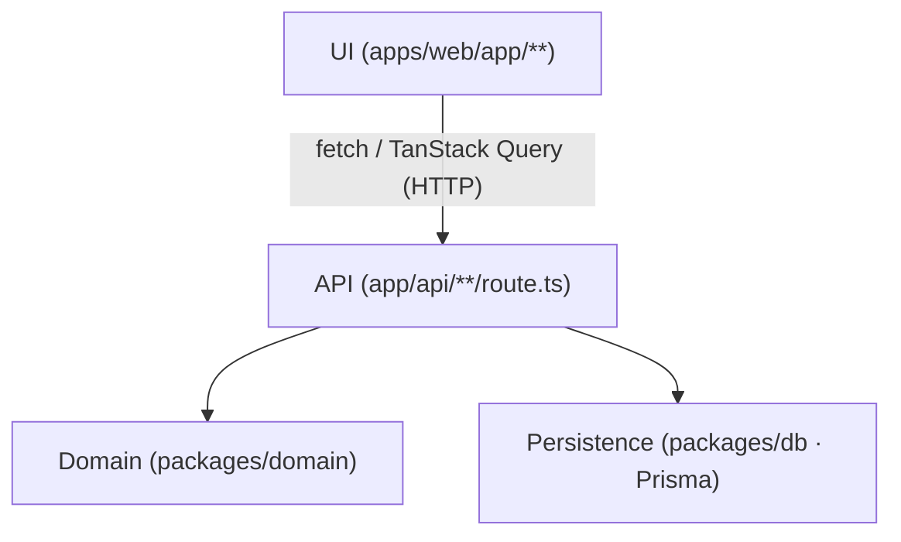

# Architecture Spine — Training Sanctum — Flashcards

## Design Paradigm

**Layered monolith with an isolated pure-domain core** (hexagonal-lite): one Next.js deployable, but the algorithmic heart (SM-2 scheduling, import parsing, duplicate detection) lives in a framework-free TypeScript package with zero knowledge of HTTP, React, or the database — unit-testable with nothing mocked, callable only through the API layer.

| Layer | Namespace | Role |
| --- | --- | --- |
| UI | `apps/web/app/**` (pages, components) | Renders state, calls the API over HTTP via TanStack Query. Never imports domain or db packages directly. |
| API (adapter) | `apps/web/app/api/**/route.ts` | Sole boundary. Validates input (Zod), calls domain for decisions, calls db for persistence, owns transactions. |
| Domain (core) | `packages/domain` | Pure functions: SM-2 engine, import parsing, duplicate detection. No HTTP/React/Prisma imports. |
| Persistence | `packages/db` | Prisma schema, generated client, migrations. No business logic. |



Dependency direction is one-way, top to bottom. Domain and Persistence have no outgoing edges to API or UI, and no edge to each other — the API layer is the only thing that knows both exist.

## Invariants & Rules

### AD-1 — Domain isolation

- **Binds:** all layering; FR-8, FR-6, FR-7
- **Prevents:** scheduling or import logic re-implemented differently in an API handler vs. a UI component vs. a future script; domain logic that can't be tested without mocking Next.js/Prisma.
- **Rule:** `packages/domain` has zero imports from `next`, `react`, `@prisma/client`, or any HTTP/db library. Every exported domain function is a pure function of its inputs. Only `apps/web/app/api/**` may import `packages/domain` — **except** that a UI component may import a pure, side-effect-free validation schema (e.g. a Zod schema) from `packages/domain` to validate input client-side before a call that has no dedicated Route Handler of its own (e.g. `signUp.email` against Better Auth's catch-all route, story 1.2). This exception covers validation schemas only, never the SM-2 engine, import parsing, duplicate detection, or any other domain logic — those remain reachable only through `app/api/**`.

### AD-2 — Single data-access path

- **Binds:** all persistence
- **Prevents:** a second ORM, a raw-SQL escape hatch in an API handler, or the UI/domain packages querying the database directly — any of which would let schema assumptions drift out of sync with `packages/db`.
- **Rule:** Postgres is reachable only through the Prisma client exported by `packages/db`. No other package instantiates `PrismaClient` or issues raw SQL. Schema changes happen only via Prisma migrations in `packages/db`.

### AD-3 — API boundary shape

- **Binds:** all client–server calls
- **Prevents:** integration tests exercising React Server Component internals instead of a real, versioned HTTP contract; a mixed Server-Actions/Route-Handlers surface with two different calling conventions.
- **Rule:** Every client–server interaction is a Next.js Route Handler under `app/api/**/route.ts`. Server Actions are not used for data mutations or queries.

### AD-4 — Grade-submission transaction (single write path for SM-2 state)

- **Binds:** FR-8, FR-17
- **Prevents:** a Scheduling Record's `interval`/`repetitions`/`ease_factor`/`next_review_date` being written from more than one code path and diverging from the SM-2 spec; enforces the PRD §5 non-goal that no manual scheduling-state edit exists.
- **Rule:** Only two Route Handlers may write these five fields (`interval`, `repetitions`, `ease_factor`, `next_review_date`, `first_graded_at`): `POST /api/review/grade` (loads the Scheduling Record **where `userId = caller`** — a record of another learner is `404`, Sprint Change 2026-11-17 — calls the pure `applyGrade` domain function, persists the result inside one Prisma `$transaction`, and sets `first_graded_at = now` only when it is null) and `POST /api/restore` (FR-14), which writes them verbatim from a validated backup export inside its own transaction, replacing existing rows rather than computing new values. No other Route Handler, script, or admin path writes them, and no path other than these two ever *computes* a new value for them outside `applyGrade`.

### AD-5 — Import logic lives in domain

- **Binds:** FR-6, FR-7
- **Prevents:** paste-import and CSV-import Route Handlers independently reimplementing (and silently diverging on) parsing or duplicate-detection rules.
- **Rule:** `parseImportBlock` and `detectDuplicates` are pure functions in `packages/domain`, called identically by the paste and CSV/Excel import Route Handlers. Import is two steps: `POST /api/import/parse` (paste text + delimiter, or file + column mapping, + `flashcardId`) returns parsed rows with source line numbers, per-row errors and duplicate flags and **writes nothing**; the user edits them in the import review editor; `POST /api/cards/batch` (the same endpoint Manual mode uses, with `source: "import"`) commits them, re-running row validation and `detectDuplicates` against the target Flashcard's current Cards inside the commit transaction, and returns the Created / Duplicates skipped / Errors groups. A Route Handler may adapt input shape (e.g. `xlsx` sheet → row array) but may not re-implement parsing or duplicate rules itself.

### AD-6 — Request validation boundary

- **Binds:** all Route Handlers
- **Prevents:** malformed or edge-case input reaching domain logic or Prisma looking superficially valid.
- **Rule:** Every Route Handler validates its body/query with a Zod schema before calling domain or db code. A validation failure returns the standard error envelope (see Consistency Conventions) and never reaches domain/db.

### AD-7 — Client data flow for the review loop

- **Binds:** FR-9
- **Prevents:** the review UI blocking on a full request/response round trip to advance, which would violate the sub-100ms perceived-transition requirement under real network conditions.
- **Rule:** The review and Learn screens (one shared session component) use TanStack Query with optimistic updates: grading a card updates local cache and advances to the next queue entry immediately, fires `POST /api/review/grade` in the background, and rolls back + surfaces an error only on failure. No other screen requires this pattern.

### AD-8 — Local day-boundary source of truth

- **Binds:** FR-8 (due-date computation), FR-12 and FR-19 (quest-day attribution and settlement)
- **Prevents:** due-queue inclusion and quest-day attribution being computed against two different clocks (e.g. server UTC day vs. client wall-clock day), which would silently desync the features the PRD requires to share one clock basis.
- **Rule:** `User.timezone` (IANA string, captured from the browser at signup, not user-editable in v1) is the single source of local-day truth. The API converts UTC "now" to `User.timezone` before (a) filtering the due queue against `next_review_date`, (b) attributing a first grade (`first_graded_at`) or a review grade to a calendar day for Daily Quest conditions, (c) choosing which days cultivation settlement covers (AD-15), and (d) attributing a Task and its Pomodoro sessions to a local day (AD-17, Sprint Change 2026-11-16). All of these call the same domain helper (`toLocalCalendarDay`).

### AD-9 — Card creation is a single shared path

- **Binds:** FR-3, FR-6, FR-7
- **Prevents:** manual card creation, paste import, and CSV import each independently deciding a new Card's `SchedulingRecord` defaults (e.g. `next_review_date` = creation instant vs. local midnight), which would be individually spine-compliant yet produce inconsistent initial due-dates depending on which entry path was used.
- **Rule:** All three creation paths call one function, `createCardWithSchedulingRecords(cardFields, learnerIds)` (in `packages/domain`, taking the five Card fields and the Class's learner ids, returning a Card + **exactly two fresh `SchedulingRecord`s per learner** — the Owner and every Member of the Class, AD-19 — at defaults `ease_factor = 2.5`, `repetitions = 0`, `next_review_date = start of today` via `toLocalCalendarDay`, AD-8, and `first_graded_at = null` — the Card is Unlearned for each learner until they grade it in Learn, FR-17). The Route Handler supplies `learnerIds` from `classLearnerIds(classId)`. No Route Handler constructs a `SchedulingRecord` by hand; adding a Member (AD-19) reuses the same record-default function for every existing Card. *(Per-learner since Sprint Change 2026-11-17.)*

### AD-10 — Response envelope & export/restore schema

- **Binds:** all Route Handlers; FR-13, FR-14
- **Prevents:** each GET endpoint independently choosing a response shape (bare array vs. `{data:[...]}` vs. `{items,total}`), and the export (FR-13) and restore (FR-14) routes drifting apart on field names/nesting since nothing currently forces them to agree.
- **Rule:** Every successful Route Handler response is `{ data: T }` (or `{ data: T[], meta?: {...} }` for paginated/listy endpoints) — defined as a shared generic type in `packages/domain/http.ts`, imported by both the Route Handler and the UI's fetch wrapper. FR-13's export payload shape and FR-14's restore input are the **same single Zod schema** (`backupExportSchema`, in `packages/domain`): the export route serializes to it, the restore route parses and validates against it — one schema, not two independently written shapes that happen to agree today. `backupExportSchema` includes `firstGradedAt` per Scheduling Record (Sprint Change 2026-11-13). It also carries `user.studyDirections`, and restore writes it back (Sprint Change 2026-11-13b). It carries `class.color` per Class; a backup that lacks it restores with colours assigned by creation order (Sprint Change 2026-11-14b). It carries a `cultivation` section — `{ xp, settledThrough, days[], xpEvents[] }` — restored verbatim, except that restore sets `settledThrough` to yesterday so no penalty is charged for the export-to-restore gap (Sprint Change 2026-11-14, AD-15). It carries a `planner` section — `{ settings, categories[], tasks[], sessions[] }` — restored verbatim; a backup without it restores with no Planner data. Planner `XpEvent`s are already inside `cultivation.xpEvents` (Sprint Change 2026-11-16, AD-17). The export covers the Classes the user **owns** — content, `members[]` (emails) and the user's own Scheduling Records — plus a `sharedClasses[]` list `{ name, ownerEmail }` for reference; a Member's records in a Shared Class are not exported. Restore recreates owned Classes with the user's records, re-attaches members whose emails resolve (creating their default records), and ignores `sharedClasses` (Sprint Change 2026-11-17, AD-19).

### AD-11 — Backup cadence, on-demand export, and destructive-operation atomicity (resolves PRD §10 Q1)

- **Binds:** §6 Data durability NFR, FR-5 (folder-delete, flashcard-delete and class-delete cascades), FR-13, FR-14
- **Prevents:** a folder-delete, flashcard-delete, class-delete (move-folders or delete-all) or a restore left half-applied by a mid-operation failure (e.g. some Flashcards moved to Unsorted/some not; some Scheduling Records restored/some not), which would itself be a silent-data-loss event.
- **Rule:** Two distinct, non-conflicting durability mechanisms: (1) Neon's built-in point-in-time-recovery / backup retention (its platform default for the plan tier in use) covers infrastructure-level durability, requiring no application code; (2) FR-13's export is strictly user-initiated and on-demand — v1 does not add a scheduled/automatic export job (additive later, not a replacement for this AD). Separately: folder-delete (both options), flashcard-delete, class-delete (both of its options, including the Unsorted merge and name-clash renames for Folders and Flashcards) (FR-5) and restore (FR-14) are each wrapped in one Prisma `$transaction` — every row changes or none do; a mid-operation failure leaves prior state fully intact, never partially applied.

### AD-12 — Testing architecture

- **Binds:** PRD §6 testability NFR
- **Prevents:** a second, divergent test-runner setup growing up for API vs. E2E tests; domain tests requiring a running server or database.
- **Rule:** Vitest runs `packages/domain` unit tests with no network/DB/browser dependency. Playwright runs both the API/integration suite (via its `request` fixture against Route Handlers, with a seeded test database) and the E2E suite (via its browser fixture against a running app). GitHub Actions runs all three suites on every push.

### AD-13 — Performance budgets

- **Binds:** FR-9, §6 general-load NFR
- **Prevents:** "fast" being a vague, unmeasurable target that different parts of the app interpret differently.
- **Rule:** In-session grade→next-card transition: sub-100ms perceived latency (enforced by AD-7's optimistic update). App open → due queue rendered: 200ms budget, measured from navigation start to due-queue paint, excluding cold serverless function start. Paste/CSV import (FR-6, FR-7): under 5 seconds of system time — the parse call (Preview click → review editor rendered) plus the commit call (Save click → Cards persisted and visible in the Folder), excluding the user's editing time in between. This bounds import batch size, not just the parse step.

### AD-14 — Learned vs. unlearned is one per-direction predicate (Sprint Change 2026-11-13, 2026-11-13b)

- **Binds:** FR-9, FR-15, FR-16, FR-17, FR-18
- **Prevents:** the Review queue, the Learn queue, the Learn button counts and Stats each deriving "learned" differently (e.g. `interval === 0`, `repetitions === 0`, or "has any grade"), or each applying the study-directions setting differently, which would let a record show up in both queues or in neither.
- **Rule:** A Scheduling Record is **learned** when `first_graded_at IS NOT NULL`. Every queue and count is filtered to the user's **studied directions**, derived once from `User.studyDirections` by a pure domain helper `studiedDirections(setting) → RecallDirection[]`. The predicates live once in `packages/domain` as Prisma-`where`-shaped builders taking those directions (plain objects, no DB import): `learnedRecordWhere(dirs)`, `unlearnedRecordWhere(dirs)`, and the Card-level `unlearnedCardWhere(dirs)` (some unlearned record in a studied direction) / `learnedCardWhere(dirs)` (none), used only for counts and Stats. They are used by `GET /api/review/queue`, `GET /api/review/learn`, the Learn counts on `GET /api/flashcards/[id]` and `GET /api/stats`. Review queue = learned, due records in studied directions. Learn queue = the Flashcard's unlearned records in studied directions (Cards in creation order, each Card's directions together, TERM_TO_DEFINITION first), followed by its learned, due records in studied directions, oldest-due-first. Records of unstudied directions are never read into a queue and never written: turning a direction off or on changes no row. The card viewer and the Learn practice run (both client-side, no grade POST) take the prompt side from the same helper. In-session "repeat until correct" (an Again entry re-shown at the end of a Learn session) is client-side practice only: the session POSTs each entry's first Grade once and never POSTs the repeats, so AD-4's single write path and the grade route's not-due 409 stay intact. Every predicate takes the viewer's `userId` and is applied to `SchedulingRecord.userId`: "learned", counts and queues are per viewer, so a Member and the Owner of the same Class see different numbers for the same Flashcard (Sprint Change 2026-11-17, AD-19).

### AD-15 — Cultivation ledger and lazy settlement (Sprint Change 2026-11-14)

- **Binds:** FR-12, FR-19, FR-13/FR-14 (cultivation section), FR-15 (XP history)
- **Prevents:** XP drifting from its history; a quest claimed twice; a missed day penalized twice (two tabs, a claim racing a page load); quest rules duplicated between UI and API; a scheduled job that v1's hosting (Vercel + Neon free tier) doesn't need.
- **Rule:**
  - The ladder (90 levels, PRD addendum), the quest table, the two quest-condition evaluators (`LEARN_FLASHCARDS`, `CLEAR_REVIEW`), `levelForXp(xp)`, `questsForLevel(level)` and `settleDays(...)` are pure functions and constants in `packages/domain/cultivation.ts` (AD-1). Route Handlers fetch the facts (counts, timestamps) and pass them in; the domain decides.
  - Only two paths write XP: (1) `POST /api/cultivation/quests/[kind]/claim`, which re-checks the quest's condition server-side and then writes one `XpEvent(+xp)` and marks the quest claimed in the day's `CultivationDay` row; (2) settlement.
  - Settlement runs at the start of `GET /api/cultivation` and of the claim route, inside one Prisma `$transaction`. It covers every local day from `User.cultivationSettledThrough + 1` to yesterday, in order. For each day it writes one `XpEvent(−2·xp)` per quest that was neither claimed nor skipped (a done-but-unclaimed quest is penalized), then advances `cultivationSettledThrough`. A day's realm (and so its Bộ, targets and XP) is the one in effect after the previous day settled.
  - The quests for a day come from its `CultivationDay` row: a snapshot of the quest kinds, targets, XP, skip flags and claim status, created on the first cultivation read of that day. A day with no row (the app wasn't opened) is rebuilt during settlement; its skip flags come from the data (Flashcards with unlearned records whose `createdAt ≤ day`; learned records with `next_review_date ≤ day`).
  - `User.cultivationXp` caches the `XpEvent` deltas applied in order with a running floor at 0. It is updated in the same transaction as each `XpEvent`. The realm is never stored; it is always `levelForXp(cultivationXp)`.
  - First run: when `cultivationSettledThrough` is null, it is set to yesterday and nothing earlier is settled. Restore sets it to yesterday too (AD-10).
  - Idempotency: unique `(userId, localDay)` on `CultivationDay`, a conditional update on `cultivationSettledThrough` (only advance from the value read), and a claim that only flips an unclaimed quest. A concurrent loser retries or returns the current state.
  - The grade route (AD-4) is not changed: quest conditions read `first_graded_at`, `updated_at` and `next_review_date`, which it already writes.
  - No cron or scheduled job.

### AD-16 — Roles, admin authorization and user management (Sprint Change 2026-11-14d)

- **Binds:** FR-1, FR-13, FR-14, FR-21
- **Prevents:** an admin route that forgets its permission check; an admin disabling or deleting themselves, or the system ending with zero admins; "view a user's data" and "export a user's data" drifting into two code paths.
- **Rule:**
  - `User.role` is `user` or `admin` (default `user`), added by an additive migration, together with a disabled flag. A disabled user cannot log in and every session they hold is deleted when they are disabled.
  - Admins are seeded at startup from the `ADMIN_EMAILS` environment variable, validated by the Config Zod schema. No route changes `role`.
  - Every `/api/admin/**` Route Handler calls one helper, `requireAdmin()`, in the auth layer: no session returns `401`, a non-admin returns `403`, both in the standard error envelope. No route writes its own role check.
  - Export, restore and the read-only user page take a target `userId` and use the same builder of `backupExportSchema` (AD-10): "view" renders the payload, "export" downloads it. Restore keeps AD-11's single `$transaction`.
  - Deleting a user runs in one `$transaction` that removes the user and everything scoped to them — including their memberships, invitations and Scheduling Records in Shared Classes; Classes they own are deleted for every learner (Sprint Change 2026-11-17, AD-19). An admin cannot disable or delete themselves, and the last admin cannot be removed.
  - Password reset sets a new hashed password and deletes the user's sessions. The admin never reads a password.
  - Option to verify in Story 7.1: Better Auth's `admin` plugin (roles, ban, set password, remove user) against the installed `better-auth` 1.7.x and the Prisma adapter. Use it if it fits; otherwise write the routes against the same Prisma client (AD-2).

### AD-17 — Pomodoro plan, server-truth timer, bounded overrun (Sprint Change 2026-11-16)

- **Binds:** FR-22, FR-23, FR-24, FR-25, FR-12 (passive XP)
- **Prevents:** the plan computed differently by the timer screen, the calendar block and the "Done?" prompt; a timer that drifts or resets on reload; two sessions running at once; an overrun cap enforced only in the UI; a second XP write path that bypasses the ledger.
- **Rule:**
  - `packages/domain/pomodoro.ts` holds pure functions (AD-1): `planPomodoro(remainingMinutes, settings) → Session[]` (focus/break with planned minutes; the last focus session is the remainder, never rounded up; a long break every N focus sessions), `remainingMinutes(task, sessions)` = `max(estimate − Σ actual focus minutes, 0)`, `overrunSessionsUsed(sessions)`, `planLengthMinutes(plan)` (focus + breaks, used by the calendar block), and `plannerXp(bộ, kind)` (PRD addendum: Planner XP table). Route Handlers pass facts in; the domain decides.
  - **Server truth.** `POST /api/planner/sessions` creates a `PomodoroSession { taskId, kind FOCUS|BREAK, plannedMinutes, startedAt = now, endedAt null, overrun bool }`. The client renders `now − startedAt` and never sends elapsed time. `POST /api/planner/sessions/[id]/end` sets `endedAt` and `actualMinutes = min(elapsed, plannedMinutes)`. A session whose planned end has passed when any `/api/planner/**` route is called is closed server-side at its planned end (`actualMinutes = plannedMinutes`) before the route proceeds. A partial unique index `(userId) WHERE endedAt IS NULL` allows one running session per user; a second start returns `409`.
  - **Bounded overrun.** A `FOCUS` session with `overrun = true` is refused with `409` when `overrunSessionsUsed(task) ≥ 2`, counted over the Task's whole life. The cap lives in the domain and the route, never only in the UI.
  - **Passive XP.** XP write paths grow from two (AD-15) to four: claim, settlement, **session end** (a `FOCUS` session that reaches `endedAt` with `actualMinutes ≥ 1`), and **task done** (the first `status = DONE`, once per Task, recorded in `Task.xpAwardedAt`). Each writes one `XpEvent` with `reason FOCUS_SESSION | TASK_DONE`, `questKind null`, `localDay` = the Task's day, and updates `User.cultivationXp` in the same transaction; the AD-15 ledger invariant is unchanged. Settlement and quest conditions never read Planner tables.
  - **Task day.** `Task.localDay` is the local day of `startAt` when set (`toLocalCalendarDay`, AD-8), else the day the user chose; a plan crossing midnight does not move it. "Move all to today" is one `PATCH /api/planner/tasks/move-overdue` inside one `$transaction` (AD-11). Nothing else changes a Task's day without the user.
  - Only Route Handlers under `app/api/planner/**` write `TaskCategory`, `Task`, `PomodoroSession` and `User.pomodoroSettings`. Category delete (move tasks / delete tasks) is one `$transaction` (AD-11).

### AD-18 — Music source adapter (Sprint Change 2026-11-16)

- **Binds:** FR-26
- **Prevents:** Jamendo request shapes and licence fields spread across components; a second catalogue later requiring a rewrite; a Jamendo outage breaking the timer.
- **Rule:** `apps/web/lib/music/` defines `MusicSource { search(query, tags): Track[]; streamUrl(trackId): string }` with one implementation, `jamendo.ts`, exposed only through `GET /api/planner/music/search` and `GET /api/planner/music/[trackId]` (responses cached one hour). `JAMENDO_CLIENT_ID` is in the Config Zod schema from Story 11.1. Playback is a plain `<audio>` element on the client (needed for the per-session fade), never an iframe. Tracks are referenced as `{ source: "jamendo", trackId }` JSON on `TaskCategory.musicTrack` / `Task.musicTrack`, so a second `source` is additive. A failed music call returns the standard error envelope and the timer proceeds. The adapter is the first outbound HTTP dependency in the product and the only module allowed to make that call.

### AD-19 — Class access, membership and invitations (Sprint Change 2026-11-17)

- **Binds:** FR-5, FR-9, FR-17, FR-19, FR-27, FR-28, FR-29
- **Prevents:** a write route that forgets the owner check; a Member seeing the Owner's progress; records created for some learners and not others; membership half-applied; two pending invitations for one person; invitations accepted by someone else.
- **Rule:**
  - **Ownership and membership.** `Class.userId` is the Owner. `ClassMember (classId, userId, createdAt)` with unique `(classId, userId)`; the Owner never has a row. `classAccess(userId, class, members) → "owner" | "member" | "none"` and `classLearnerIds(class, members)` (owner + members) are pure functions in `packages/domain/access.ts` (AD-1).
  - **Two guards, in the auth layer, used by every class-scoped route:** `requireClassOwner(classId)` on every write to a Class, its Folders, Flashcards, Cards, colour, imports and sharing — `403` for a Member, `404` for a stranger; `requireClassAccess(classId)` on every read and on `review/queue`, `review/learn`, `review/grade` and `flashcards/[id]` — `404` for a stranger. No route writes its own check.
  - **Scheduling Records are per learner.** `SchedulingRecord.userId` (required) with unique `(userId, cardId, direction)` and index `(userId, nextReviewDate)`. The migration adds the column, backfills `userId = Card.userId`, then swaps the unique index; it is dry-run on a Neon branch with a before/after row count. Every query on records filters by the caller's `userId` (AD-14). `Card.userId` stays the Owner's and is the authority for ownership checks on a Card.
  - **Membership transitions are single transactions (AD-11).** *Accept:* insert `ClassMember`, insert two default records per Card for the invitee (batched), mark the Invitation `ACCEPTED`. *Leave / Remove:* delete the member row and that member's records in the Class. *Card creation:* records for every learner (AD-9). *Flashcard move across Classes:* delete records of learners not in the target, create defaults for target learners who lack them, inside the move transaction. *Owner deletes:* the existing cascades remove every learner's records; `GET /api/classes/[id]` returns `memberCount` for the confirmation beforehand.
  - **Invitations.** `ClassInvitation (classId, inviterId, inviteeId, status PENDING | ACCEPTED | DECLINED | CANCELLED, createdAt, respondedAt?)` with a partial unique `(classId, inviteeId) WHERE status = 'PENDING'`. Invite resolves the email to a `User` id server-side (`400` field error when unknown, the Owner's own, a Member's, or pending); only the invitee accepts or declines (`404` otherwise); only the Owner cancels (`403` otherwise). No expiry, no email.
  - **Bell.** `GET /api/invitations` returns the caller's pending Invitations with Class name, Owner name and card count; the badge is its length. No `Notification` table in v1; the bell carries Invitations only.
  - Quests (AD-15) and Stats read the caller's records only, so Shared Classes count for a Member without any change to the quest rules.

## Consistency Conventions

| Concern | Convention |
| --- | --- |
| Naming (entities, files) | Domain vocabulary is binding: `Class`, `Folder`, `Flashcard`, `Card`, `SchedulingRecord`, `User` — Prisma model names match these exactly, no translation layer between schema and PRD glossary. Only exception: if Prisma rejects `Class` as a reserved model name, use `StudyClass` with `@@map("class")` and keep "Class" everywhere in UI and API paths. |
| IDs | All primary keys are Prisma-generated `cuid()` strings. |
| Dates & timezone | All timestamps stored in UTC. Local-day computations go through `User.timezone` per AD-8 — never a raw client `Date` or server-local timezone. |
| Error envelope | Every Route Handler error response is `{ error: { code: string, message: string, fields?: Record<string, string>, details?: { line: number, reason: string }[] } }`, HTTP status matching `code`. `fields` is for single-record field-level errors (FR-3: one bad field per request); `details` is for batch/line-numbered errors (FR-6/FR-7: one entry per failed row). A response uses at most one of the two, never both, and never a bare string or toast-only message. |
| State & mutation | Only Route Handlers mutate persisted state (AD-1, AD-2, AD-4). Client state (TanStack Query cache) is a projection, never a source of truth. |
| Observability | Every write path that can silently lose data if it fails partway (import commit, grade write, export, restore, user disable, password reset, user delete, folder-delete, flashcard-delete and class-delete cascades, Pomodoro session end, task done, move-overdue, category-delete cascade, invitation accept, member leave / remove, cross-class flashcard move) logs a structured, single-line summary (operation, record counts including flashcard counts, outcome) on completion or failure — enough to audit "did this actually happen" against the §6 durability NFR. Full APM/tracing is out of scope for v1 (see Deferred). |
| Auth | Better Auth session cookie required on every Route Handler except `/api/auth/**`; unauthenticated requests return `401` with the standard error envelope. `/api/admin/**` additionally requires `role = admin` (AD-16), else `403`. Every class-scoped route calls `requireClassOwner` (writes) or `requireClassAccess` (reads and study), AD-19. Session lifetime is a fixed 30-day sliding window (refreshed on activity) — resolves PRD §10 Open Question 2. |
| Config | Environment variables validated against a Zod schema at process start (`DATABASE_URL`, `BETTER_AUTH_SECRET`, `ADMIN_EMAILS`, `JAMENDO_CLIENT_ID` from Story 11.1, etc.); the app fails fast on a missing/malformed var rather than failing deep inside a request. |
| External calls | Only `apps/web/lib/music/jamendo.ts` makes outbound HTTP (AD-18). A failure there is returned in the error envelope by its Route Handler and never thrown into a page; no other feature waits on it. *(Sprint Change 2026-11-16.)* |
| Text encoding (Unicode) | All five Card text fields are Postgres `TEXT` columns with the database's default UTF-8 encoding; no ASCII/Latin-1 collation, no server-side normalization or stripping of non-Latin scripts, combining diacritics, or IPA symbols. Resolves PRD §6 "Accessibility of input" NFR. |

## Stack

| Name | Version |
| --- | --- |
| Next.js | 16.x (App Router, Turbopack default, Node 20+) |
| TypeScript | 5.x |
| Prisma | 7.8.x |
| Postgres (hosted) | Neon, free tier |
| Better Auth | current stable, `@better-auth/prisma-adapter` (or the version-matched `better-auth/adapters/prisma` subpath — confirm against whichever Better Auth version is pinned at build time) (Vercel-backed successor to Auth.js/NextAuth, which is now maintenance-only) |
| TanStack Query | v5 |
| Zod | latest 3.x/4.x |
| Tailwind CSS | v4, CSS variables mapped to `DESIGN.md` tokens |
| Vitest | latest |
| Playwright | latest |
| Font | Plus Jakarta Sans via `next/font/google` (latin, vietnamese) (Sprint Change 2026-11-14b) |
| Hosting | Vercel |
| CI | GitHub Actions |

## Structural Seed

```text
training-sanctum/
  apps/
    web/
      app/
        (routes)/              # pages: review, classes (→ class → folder → flashcard, incl. Add cards: manual + import on the flashcard page), planner (segments: tasks, calendar, pomodoro — one nav item), cultivation (replaces stats), settings
        api/
          auth/[...all]/       # Better Auth handler
          classes/              # Class CRUD + class-delete (move folders / delete all); GET [id] returns memberCount
            [id]/members/       # GET members + invitations (owner); DELETE [userId] remove (owner); POST leave (member) — AD-19
            [id]/invitations/   # POST invite by email (owner); DELETE [id] cancel (owner) — AD-19
          invitations/          # GET mine (pending, the bell); POST [id]/accept; POST [id]/decline — AD-19
          folders/              # Folder CRUD (always under a class); GET returns the folder's Flashcards with card counts
          flashcards/           # Flashcard CRUD (always under a folder); POST flashcards/[id]/move moves a Flashcard to any Folder
          cards/                # Card CRUD; cards/batch (takes `flashcardId`) = the single multi-row create used by Manual mode and import commit
          import/parse/         # paste + CSV/Excel parse for a flashcardId — read-only, returns rows for the review editor
          review/
            queue/              # GET due queue of learned Cards; optional ?classId= or ?folderId= scope (FR-9, AD-14)
            learn/              # GET Learn queue for ?flashcardId= (required): unlearned entries then due entries, plus counts (FR-17, AD-14)
            grade/               # POST grade (AD-4)
          settings/              # GET/PATCH the user's study-directions setting (FR-18, AD-6)
          stats/
          cultivation/           # GET: settle past days, then realm, XP and today's quests (FR-12, FR-19, AD-15)
            quests/[kind]/claim/ # POST: claim one of today's quests (AD-15)
          admin/                 # FR-21, AD-16: requireAdmin() on every handler
            users/               # GET list with levels; GET [id] read-only payload; PATCH [id] disable/enable; DELETE [id]
              [id]/export/       # GET FR-13 (target user)
              [id]/restore/      # POST FR-14 (target user)
              [id]/password/     # POST reset password
          planner/               # FR-22–FR-26, AD-17/AD-18 (Sprint Change 2026-11-16)
            categories/          # CRUD; DELETE asks move-or-delete (AD-11 transaction)
            tasks/               # CRUD; GET ?day= ; PATCH [id] (incl. day/start from calendar drag)
              move-overdue/      # PATCH: all overdue → today, one transaction
              [id]/done/         # POST: mark done, award TASK_DONE once
            sessions/            # POST start (409 if one running / overrun cap); GET running
              [id]/end/          # POST end; awards FOCUS_SESSION
            settings/            # GET/PATCH User.pomodoroSettings
            music/search/        # AD-18
            music/[trackId]/     # AD-18
        components/
      lib/                      # TanStack Query client, API fetch wrappers
        music/jamendo.ts        # the one MusicSource implementation (AD-18)
  packages/
    domain/
      sm2.ts                    # FR-8 engine
      import.ts                 # FR-6/FR-7 parsing + duplicate detection
      cultivation.ts            # FR-12, FR-19: ladder, quests, settlement (AD-15), uses toLocalCalendarDay (AD-8)
      pomodoro.ts               # FR-23/FR-24: planPomodoro, remainingMinutes, overrunSessionsUsed, planLengthMinutes, plannerXp (AD-17)
      access.ts                 # classAccess, classLearnerIds (AD-19)
      time.ts                   # toLocalCalendarDay helper
    db/
      schema.prisma             # Class, Folder, Flashcard, Card, SchedulingRecord (userId), ClassMember, ClassInvitation, User (role, disabled, pomodoroSettings), CultivationDay, XpEvent, TaskCategory, Task, PomodoroSession
      client.ts                 # exported Prisma client singleton
  tests/
    domain/                     # Vitest
    api/                        # Playwright request fixture
    e2e/                        # Playwright browser fixture
```

### Core entities (ERD)

```mermaid
erDiagram
  USER ||--o{ CLASS : owns
  CLASS ||--|{ FOLDER : "contains (incl. 1 Unsorted)"
  USER ||--o{ CARD : owns
  FOLDER ||--o{ FLASHCARD : contains
  FLASHCARD ||--o{ CARD : contains
  CARD ||--|| SCHEDULING_RECORD : "term->definition"
  CARD ||--|| SCHEDULING_RECORD : "definition->term"
  USER ||--o{ CULTIVATION_DAY : "quest days"
  USER ||--o{ XP_EVENT : "XP ledger"
  USER ||--o{ TASK_CATEGORY : owns
  TASK_CATEGORY ||--o{ TASK : labels
  USER ||--o{ TASK : owns
  TASK ||--o{ POMODORO_SESSION : "focus/break log"
  USER ||--o{ SCHEDULING_RECORD : "owns (per learner)"
  CLASS ||--o{ CLASS_MEMBER : has
  USER ||--o{ CLASS_MEMBER : "is member"
  CLASS ||--o{ CLASS_INVITATION : has
  USER ||--o{ CLASS_INVITATION : invitee
```

**Shared Classes (Sprint Change 2026-11-17, AD-19).** A `Card` has exactly two `SchedulingRecord`s **per learner of its Class** (Owner + Members), one per Recall Direction, enforced by the Card-creation and membership Route Handlers, with a unique `(userId, cardId, direction)` index and an index `(userId, nextReviewDate)`. `SchedulingRecord.userId` is required; its migration adds the column, backfills `userId = Card.userId`, then replaces the old unique `(cardId, direction)` — the one non-trivial migration in the product, dry-run on a Neon branch with a before/after row count, then deployed with the code. `ClassMember (classId, userId)` is unique per pair; `ClassInvitation (classId, inviterId, inviteeId, status, createdAt, respondedAt?)` has a partial unique on `(classId, inviteeId) WHERE status = 'PENDING'`. All three cascade on user delete. The "exactly two records per Card" sentence in the paragraph after next describes a single learner and still holds per learner.

**Planner entities (Sprint Change 2026-11-16, AD-17).** `TaskCategory (userId, name, color ClassColor, musicTrack Json?)`, unique `(userId, name)` case-insensitive. `Task (userId, categoryId, title, localDay date, startAt timestamptz?, estimateMinutes int ≥ 5, status OPEN | DONE, doneAt?, xpAwardedAt?, musicTrack Json?, order int)`. `PomodoroSession (userId, taskId, kind FOCUS | BREAK, plannedMinutes, actualMinutes?, startedAt, endedAt?, overrun bool)` with a partial unique index `(userId) WHERE endedAt IS NULL`. `User.pomodoroSettings` is JSON, default `{ focus: 25, shortBreak: 5, longBreak: 15, longBreakEvery: 4 }`. **`XpEvent.questKind` becomes nullable** and `XpEventReason` gains `FOCUS_SESSION` and `TASK_DONE`; existing rows are untouched. All relations cascade on user delete (AD-16). One additive migration per epic — 8: `TaskCategory`, `Task`, the `XpEvent` change; 9: `PomodoroSession`, `User.pomodoroSettings`; 10: none expected; 11: the two `musicTrack` columns — each deployed to Neon with its code.

A `Card` always has exactly two `SchedulingRecord`s (one per Recall Direction, AD enforced by the Card-creation Route Handler, not a DB constraint beyond a unique `(cardId, direction)` index). Every `Class` has exactly one `Folder` with `isUnsorted = true`, created in the same transaction as the Class and enforced by a partial unique index on `(classId) WHERE isUnsorted`. `Class` carries `color`, a required enum of five values (lavender, sky, mint, butter, rose) assigned at creation; its migration backfills existing Classes by creation order (Sprint Change 2026-11-14b). `Folder.classId`, `Flashcard.folderId` and `Card.flashcardId` are required (non-null) — there is no Card without a Flashcard, no Flashcard without a Folder and no Folder without a Class. `Flashcard` carries only a `name`, unique per Folder case-insensitively, and `Card` also carries `userId`. `SchedulingRecord` carries `first_graded_at` (nullable UTC timestamp, AD-14). Its migration adds the column and backfills `first_graded_at = updated_at` where `interval > 0` — the only rows ever graded, since `applyGrade` never returns interval 0. `User` carries `studyDirections` (enum `BOTH | TERM_TO_DEFINITION | DEFINITION_TO_TERM`, non-null, default `BOTH`, FR-18). Its migration adds the column with the default, so every existing account keeps studying both directions. A Card still always has both Scheduling Records whatever the setting (AD-9 unchanged). `User` also carries `cultivationXp` (int, default 0) and `cultivationSettledThrough` (date, nullable) (AD-15). `CultivationDay` is `(userId, localDay date, quests JSON)` with a unique `(userId, localDay)`; `XpEvent` is `(userId, localDay date, questKind, delta int, reason CLAIM | PENALTY, createdAt)`, append-only. Both migrations are additive.

### Deployment & environments

- **Production:** Vercel project (web app) + Neon production branch (Postgres). Env vars set in Vercel project settings.
- **Preview:** Vercel preview deployments per branch/PR, each paired with a Neon branch (serverless branching) seeded from a minimal fixture set — not a copy of production data.
- **CI:** GitHub Actions spins up a disposable Postgres (Neon branch or local container) for the API/integration suite; no shared test database across runs.
- **Local dev:** `.env.local` pointing at a local or personal Neon dev branch; `prisma migrate dev` is the only way schema changes are made locally.

## Capability → Architecture Map

| Capability / Area | Lives in | Governed by |
| --- | --- | --- |
| FR-1, FR-2 Auth & session | `app/api/auth/**`, Better Auth config | Stack (Better Auth), Consistency Conventions (Auth) |
| FR-3, FR-4 Card CRUD | `app/api/cards/**` | AD-2, AD-6, AD-9 |
| FR-5 Class, Folder & Flashcard CRUD (incl. Flashcard move) | `app/api/classes/**`, `app/api/folders/**`, `app/api/flashcards/**` | AD-2, AD-6, AD-11 |
| FR-6, FR-7 Import (mode of a Flashcard's Add cards) | `app/api/import/**`, `packages/domain/import.ts` | AD-5, AD-6, AD-9, AD-13 |
| FR-8 SM-2 engine | `packages/domain/sm2.ts`, `app/api/review/grade` | AD-1, AD-4 |
| FR-9, FR-11 Review session | `app/(routes)/review`, `app/api/review/queue`, `app/api/review/grade` | AD-4, AD-7, AD-13, AD-14 |
| FR-16 Card viewer | `app/(routes)/flashcards/[id]` (reads the existing `GET api/flashcards/[id]`) | AD-2, AD-14 |
| FR-17 Learn session | `app/(routes)/flashcards/[id]/learn`, `app/api/review/learn`, `app/api/review/grade` | AD-4, AD-7, AD-14 |
| FR-18 Study directions | `app/(routes)/settings`, `app/api/settings`, `packages/domain/learned.ts` | AD-2, AD-6, AD-14 |
| FR-12 Cultivation, FR-19 Daily Quests | `packages/domain/cultivation.ts`, `app/api/cultivation/**`, `app/(routes)/cultivation` | AD-1, AD-8, AD-14, AD-15 |
| FR-13, FR-14 Export/restore (admin-only, per user) | `app/api/admin/users/[id]/export`, `app/api/admin/users/[id]/restore` | AD-2, AD-4, AD-6, AD-10, AD-11, AD-15, AD-16 |
| FR-21 Admin user management | `app/api/admin/**`, `app/(shell)/admin/**` | AD-2, AD-6, AD-10, AD-11, AD-16 |
| FR-15 Stats (on the Cultivation page) | `app/api/stats`, `app/(routes)/cultivation` | AD-2, AD-10 |
| FR-22 Tasks & categories | `app/api/planner/{categories,tasks}/**`, `app/(routes)/planner` (Tasks segment) | AD-2, AD-6, AD-8, AD-11, AD-17 |
| FR-23, FR-24 Pomodoro | `packages/domain/pomodoro.ts`, `app/api/planner/sessions/**`, `app/api/planner/settings`, `app/(routes)/planner` (Pomodoro segment) | AD-1, AD-6, AD-15, AD-17 |
| FR-25 Calendar | `app/(routes)/planner` (Calendar segment), `app/api/planner/tasks` | AD-8, AD-17 |
| FR-26 Music | `lib/music/jamendo.ts`, `app/api/planner/music/**` | AD-18 |
| FR-27 Invitations & bell | `app/api/classes/[id]/invitations/**`, `app/api/invitations/**`, bell component | AD-6, AD-11, AD-19 |
| FR-28 Member study | `app/api/review/**`, `app/api/flashcards/[id]`, `packages/domain/access.ts`, Classes pages | AD-4, AD-14, AD-19 |
| FR-29 Lifecycle (fan-out, leave, remove, cascades, cross-class move) | `app/api/classes/[id]/members/**`, `app/api/cards/**`, `app/api/flashcards/[id]/move`, delete routes | AD-9, AD-11, AD-16, AD-19 |

## Deferred

- **Light-mode contrast verification** (sage background × white cards × charcoal text) — flagged `[ASSUMPTION]` in `DESIGN.md` as unverified; resolve during UI build, not an architectural concern.
- **Grade-distribution / quest-pressure monitoring (PRD SM-C1)** — the only v1 mitigation is that no quest or XP rule reads grade values (AD-15); no grade-distribution check is built.
- **`User.timezone` editability** — v1 captures it once at signup (AD-8) and does not expose a settings UI to change it; revisit if a user ever travels across timezones, since a timezone change would shift quest days and settlement.
- **Beyond Shared Classes (AD-19)** — ownership transfer, nested sharing (a Member inviting others), sharing a single Folder or Flashcard, email or push notifications, and a general `Notification` table stay out of scope; the bell carries Invitations only. Team or organisation accounts remain out of scope. *(Reworded by Sprint Change 2026-11-17; sharing itself is now in scope.)*
- **CSV/Excel parsing library choice** (e.g. `papaparse` vs `exceljs` vs `xlsx`) — implementation-level seed, not architecturally load-bearing; pick at build time behind the `packages/domain/import.ts` boundary (AD-5) without needing a spine update.
- **Sign-up abuse protection** — registration is open and relies on Better Auth's built-in rate limit. Revisit if registration should be limited to known users (see Sprint Change 2026-11-14d, open risks).
- **Full observability/APM** — v1 relies on structured single-line logs for write paths (see Consistency Conventions) plus Vercel/Neon's built-in platform logs; no dedicated tracing/metrics/alerting stack. Revisit if the product gains real concurrent/multi-user load.
- **Second music source** (Audius, Radio Browser) — additive behind `MusicSource` (AD-18); not in v1.
- **Planner quests or penalties** — rejected in the forge session of 2026-11-16; the `PomodoroSession` log is rich enough to add one later without a migration.
- **Jamendo terms (page dated 2013) and catalogue quality** — unverified at planning time; Story 11.1 checks both first and stops if either fails (see `deferred-work.md`).
